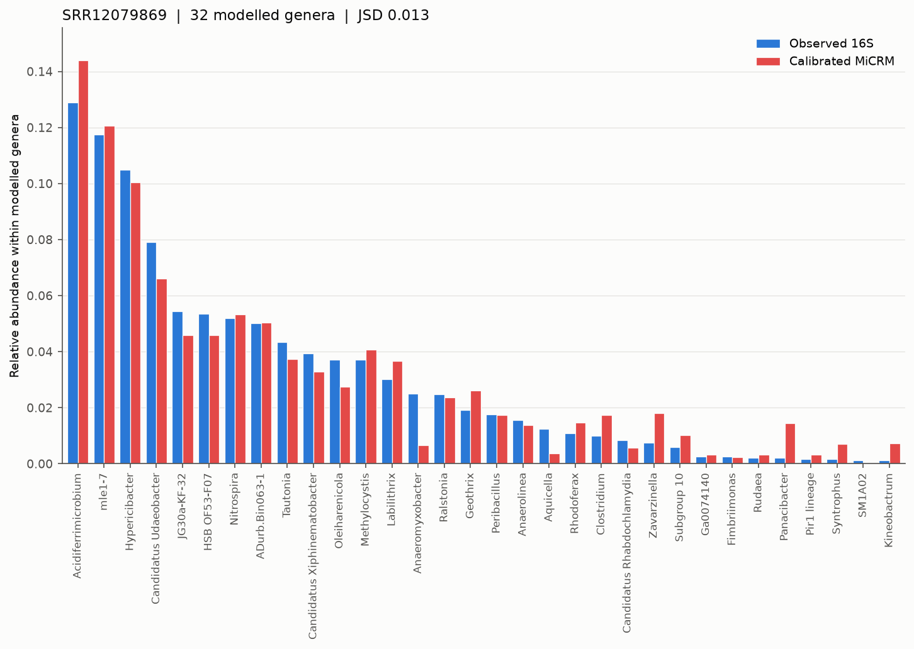

# GEM-CRM workflow

Go from raw 16S FASTQ files to a "MiCRM simulated abundance vs 16S observed abundance" comparison bar chart in one command.
No data, caches or pre-built GEMs are included. All required reference databases, genomes and GEMs are downloaded or built automatically on the first run and cached, so they can be reused directly when you switch to new data.



*Example output: observed 16S relative abundances (blue) and calibrated MiCRM relative abundances (red) across modelled genera.*

## Directory layout

```
GEM-CRM/
├── main.py              # One-command entry point; runs the 6 steps in order
├── config.toml          # All tunable parameters (paths, threads, thresholds, MiCRM settings)
├── environment.yml      # conda environment (R/DADA2, gapseq, barrnap, mash, NCBI datasets, h5py)
├── workflow/            # Function files for each step
│   ├── denoise.py / denoise.R    # Step 1: DADA2 denoising + SILVA classification to genus
│   ├── genomes.py                # Step 3: NCBI reference genomes + 16S Mash selection + similar-genus/family fallback
│   ├── gems.py                   # Step 4: build GEMs with gapseq (resumable)
│   ├── parameterize.py           # Step 5: sequence-supported uptake, resource panel, K
│   ├── maintenance.py            # Step 5: cell size -> m
│   ├── kinetic_helpers.py + resources/kinetics_evidence.csv   # Literature evidence for K
│   ├── micrm.py                  # Step 6: U/L estimation, calibration, simulation, evaluation, plotting
│   ├── prior.py                  # Step 5: MicrobeAtlas genus x environment abundance prior (built on first use)
│   ├── calibrate.py              # Step 6: equal uptake budget, uptake capacity from the prior, supply from the sample
│   ├── crm_solver.py             # Step 6: MiCRM in log-biomass with an exact Jacobian
│   ├── estimate.py, network.py, entropy_solver.py   # U/L estimation core (from micrm_shared, unchanged)
│   ├── ul_core.py                # SBML parsing (originally vendored, unchanged)
│   ├── databases.py, common.py   # Tool checks, reference database download, common functions
├── 16data/              # <- Put the raw FASTQ files here
├── databases/           # Auto-downloaded: SILVA training set, Madin trait table, microbeatlas/ prior table
├── genomes/             # Auto-cached: NCBI taxonomy queries, genomes, 16S, selection records
├── gems/                # Auto-built: gapseq models (one folder per accession) + U/L computation cache
└── results/             # Per-community results, figures/, summary.csv
```

## Installation

```bash
conda env create -f environment.yml
conda activate micrm16s
python main.py --check      # Check tools and pre-download SILVA (about 140 MB) and the Madin table
```

An internet connection is required: NCBI (taxonomy + datasets), Zenodo (SILVA), GitHub (Madin table), MicrobeAtlas (prior, first run only: ~3.6 GB download and ~16 GB temporary disk, afterwards only a ~30 MB table is kept), and the sequence libraries that gapseq downloads by itself on first run. If NCBI requests are rate-limited, you can request an API key and put it in `ncbi_api_key` in `config.toml`, or set the environment variable `NCBI_API_KEY`.

## Running

```bash
# Put the FASTQ files into 16data/
python main.py
```

- **One FASTQ = one community**, and the file name is the community name. `.fastq(.gz)` and `.fq(.gz)` are supported, and files may also be placed in subfolders.
- Paired-end data (`xxx_R1/_R2`, `xxx_1/_2`, `xxx_R1_001`) are detected automatically and only R1 is used, consistent with the original workflow.
- After an interruption, just run `python main.py` again; completed parts are skipped: already denoised communities, already selected genomes, already built GEMs, and simulations whose inputs have not changed.
- Common options:
  - `--steps params,simulate`: rerun only parameterization and simulation (e.g. after changing `[micrm]` in `config.toml`).
  - `--rerun`: force the simulation to rerun.
  - `--replot`: only redraw the figures from finished simulations (e.g. after changing `plot_scale`).
  - `--communities A,B`: run only the specified communities.
- gapseq modelling of several dozen genera can take from a few hours to a day, so it is recommended to run on a server with `nohup python main.py > run.log 2>&1 &`. The number of threads is set in `[compute]`.

## What each step does

1. **Denoising (DADA2, forward reads only)**: truncLen = min(modal read length, 230). If the quality scores are nearly constant, `noqualErrfun` is used automatically. After a first failure, it retries once with relaxed parameters (no truncation, maxEE 5, noqual). Finally, ASVs are classified to genus with SILVA 138.2. Only ASVs with Kingdom = Bacteria and a genus assignment go into modelling.
2. **Genus summary**: collect the ASV sequences of each genus across communities, together with the family assigned by SILVA.
3. **Reference genomes**: tried in the following order, stopping at the first hit:
   1. A genus of the same name in NCBI (restricted to Bacteria)
   2. Aliases for combined labels (Escherichia-Shigella -> Escherichia + Shigella)
   3. Similar genus: extract the genus name from the label, e.g. `[Eubacterium] xx group` -> Eubacterium, `Clostridium sensu stricto 1` -> Clostridium, and hyphenated combinations are split into individual genera
   4. **Family fallback**: reference genomes of other genera in the same family, one per genus
   5. If none is found, skip

   Within each tier, the search order is: NCBI reference -> type material -> any annotated assembly, taking up to `max_candidates` candidates. The 16S sequences of the candidate genomes are extracted with barrnap and compared with the ASVs of that genus using Mash, and the closest candidate is selected. The origin is recorded in the `source` column of `results/genus_references.csv`.
4. **GEM**: gapseq find -> find-transport -> draft -> medium -> fill. Each stage has a checkpoint, stored in `gems/<accession>/`, and GEMs that have already been built are reused directly.
5. **Parameter preparation** (one set per community, stored in `results/<community>/02_inputs/`):
   - **Binary uptake matrix** `binary_uptake.csv`: a carbon compound (not $\mathrm{CO_2}$ / $\mathrm{HCO_3^-}$) is marked 1 only if (1) the final GEM has an extracellular exchange and a transport reaction for it, (2) that transport is already in gapseq's draft model, i.e. it was not added by gap-filling, and (3) gapseq's find-transport found a transporter sequence for it (`genome-Transporter.tbl`). Without (2)-(3) about half of each GEM's "importable" compounds have no genomic support, and in the MiCRM the genera with the most complete models win regardless of their real abundance. Cached per GEM in `gems/<accession>/uptake_inventory.json`.
   - **Resource panel**: the union of the resources that can be taken up by all modelled genera in the community; all of them may be supplied, and how much of each is inferred in step 6.
   - **$K$**: from literature records of whole-cell uptake, converted to $\mathrm{mM\ C}$, taking the geometric mean for the same substrate. Substrates without evidence fall back to the global geometric mean ($0.01262\ \mathrm{mM\ C}$). The same resource uses the same $K$ across all genera.
   - **$m$**: cell volume $V$ is calculated from the cell diameter and length in Madin et al. 2020, and $m = 0.01449\,V^{-0.09}$.

     Genera without trait data are assigned a random value within the known volume range (seed 42). This is a per-genus table lookup, **not inferred from genes**.
   - **MicrobeAtlas prior** `prior.csv`: each genus's mean relative abundance in the `[prior] environment` class of MicrobeAtlas (~1.75 million single-environment samples; relative to reads of bacterial OTUs). Built on first use into `databases/microbeatlas/` (`prior.py`).
6. **Simulation** (`results/<community>/03_micrm/`):
   - **$U$**: for each genus $\times$ resource pair, supply 1 unit of carbon, find the first feasible retention fraction in a prior order, then use LP to find the minimum carbon flux burden $B$, with $u = \frac{10}{1+B}$.
   - **$L$**: take the maximum output entropy over the same feasible flux polytope as the leakage allocation. `binary_leakage.csv` lists every substrate -> product combination.
   - **Equal uptake budget**: each genus's uptake row is rescaled to the same total capacity, spread over the carbon sources it can import. Being able to use many substrates makes a genus broad, not a bigger eater; without this, the completeness of a GEM decides who wins. Genera represented by the same genome share one maintenance rate $m$.
   - **Uptake capacity $s$ from the prior (`calibrate.py`, `prior.py`)**: each genus's typical relative abundance in the configured environment class (`[prior] environment`, e.g. `soil`) is taken from MicrobeAtlas. The smallest per-genus scaling $s$ of the uptake capacity that makes these *typical* abundances a steady state is the genus's intrinsic competitiveness. The sample's own abundances are never used for $s$.
   - **Nutrient supply $\rho$ from the sample**: with $U$ and $s$ fixed, an LP finds resource levels at which every genus breaks even and the supply that makes the observed abundances a steady state (closest to a uniform medium). Genera that cannot break even at any common resource state are listed in `metadata.json`, not corrected. Observed abundances are never put into $U$ or $L$, which would turn abundance into competitive rank and drive rare genera extinct.
   - **MiCRM (`crm_solver.py`)**: integrated in log-biomass with an exact Jacobian from uniform initial biomass, so genera at $10^{-5}$ relative abundance are not lost to the solver's tolerance. Every genus's final per-capita growth rate is reported; the equilibrium's leading Jacobian eigenvalue is reported as a stability check.
   - **Evaluation**: *leave-one-genus-out* — for each genus the supply is re-inferred without its abundance, the full community is simulated, and its predicted abundance is compared with the observed one (`leave_one_out = false` turns it off); the calibrated fit uses the sample's abundances for the supply and is within-sample. *Genome-only baseline* — equal-budget genome traits with a uniform medium and no abundance information.
   - **Plotting**: one grouped bar chart per community, genera sorted by observed abundance: blue = observed 16S, red = calibrated MiCRM. Linear y-axis by default (`plot_scale = "log"` in `[micrm]` shows rare genera better). Leave-one-out and genome-only scores are in `metadata.json` and `summary.csv`. Redraw figures without re-simulating: `python main.py --replot`.

## Main outputs

| File | Content |
|---|---|
| `results/summary.csv` | Per-community status, genera, resources, coverage, genera found in the prior, JSD, genera retained (all / rare), leave-one-out Spearman and retention, genome-only JSD and retention, number of uptake corrections |
| `results/figures/<community>.png` | MiCRM vs 16S comparison bar chart |
| `results/genus_references.csv` | Genome selected for each genus, source (genus / alias / related_genus / family_surrogate), Mash distance |
| `results/gem_catalog.csv` | genus -> GEM path and status |
| `results/maintenance.csv` | Volume, $m$ and source for each genus |
| `results/<community>/01_dada2/` | asvs.csv, counts.csv, qc.csv, quality.png |
| `results/<community>/02_inputs/` | genera / resources / observed / kinetics / maintenance / binary_uptake / prior (MicrobeAtlas abundance and how it was matched) |
| `results/<community>/03_micrm/` | parameters.npz ($U$ used, equal-budget $U$, genome $U$, uptake capacity $s$, $L$, $K$, $m$, $R_0$, inferred $\rho$, prior), environment.csv (uniform vs inferred supply, steady-state $R$), abundance_comparison.csv (observed, calibrated, leave-one-out, genome-only, prior, $s$, break-even flag, final growth rate), parameter_audit.json, simulation.json, comparison.png, metadata.json (all scores) |

## Notes

- **Prior coverage**: genera are matched to MicrobeAtlas by SILVA lineage, then by a unique genus name; genera not found (e.g. names introduced in newer SILVA releases, or uncultured clades) get the median prior of the found genera (`match = missing_median` in `prior.csv`). The number found is in `summary.csv` (`prior_matched`).
- **Prior and new data**: the prior table is built once and excludes the runs present in `16data/` at that time, and every sample from their studies. If later data come from a study MicrobeAtlas already contains, step 5 logs a warning; delete `databases/microbeatlas/` to rebuild the prior without them.

- `kinetics_evidence.csv` is the literature evidence for $K$ (part of the method), so it is shipped together with the code.
- A family-fallback result is a "representative close-relative genome" and is less reliable than a same-genus match. You can filter out those rows in `genus_references.csv`, or set `family_fallback = false` in the config.
- Communities with fewer than 2 usable GEMs are marked as skipped, with the reason written to summary.csv.
